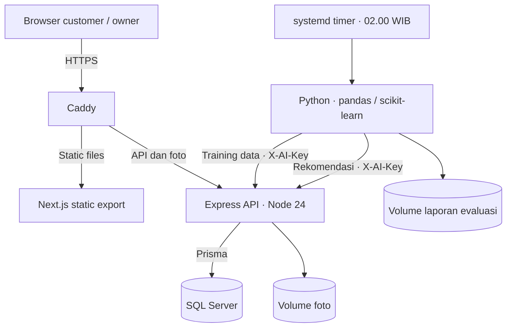

# Arsitektur deployment Replate

Frontend statis, API, database, dan batch rekomendasi berjalan pada satu VPS melalui Docker Compose. Caddy menjadi pintu masuk HTTPS; API dan SQL Server hanya diakses melalui jaringan internal container.

## Alur aplikasi

1. Browser memuat hasil static export Next.js dari Caddy.
2. Permintaan `/api/*` serta foto `/uploads/*` dan `/menu-uploads/*` diteruskan ke Express.
3. API memvalidasi JWT dan kepemilikan data sebelum membaca atau menulis SQL Server melalui Prisma.
4. Foto disimpan di volume persisten; database menyimpan URL dan urutannya.
5. Timer menjalankan container batch harian. Python mengambil data melalui API internal, memeriksa kualitas data, mengevaluasi model, dan mengirim rekomendasi untuk disimpan.
6. Owner membaca hasil tersimpan melalui endpoint dengan pemeriksaan kepemilikan restoran. Catatan per menu/tanggal diperbarui saat batch diulang.

## Akses dan penyimpanan

| Komponen | Akses | Data persisten |
| --- | --- | --- |
| Caddy | Port publik 80/443; sertifikat HTTPS | Volume sertifikat dan konfigurasi |
| Frontend | Berkas statis melalui Caddy | Hasil build pada image |
| API | Jaringan container; diproksi Caddy | Volume foto |
| SQL Server | Jaringan container; login aplikasi terpisah | Volume database |
| Batch AI | Jaringan container; kunci layanan privat | Volume laporan evaluasi |

Caddy menolak `/api/internal/*` dari akses publik. Batch tetap wajib menyertakan kunci layanan. Kunci JWT, kredensial SQL, dan kunci batch disediakan melalui environment privat pada server.

GitHub Actions menjalankan lint, tes, dan build; deployment server serta penjadwalan systemd mengikuti [panduan VPS](../../deploy/README.md). Konfigurasi Compose sudah divalidasi dan alur batch sudah diuji terhadap SQL lokal. Build image container, HTTPS publik, backup/restore, dan eksekusi timer pada VPS masih perlu diverifikasi.

Detail fitur, evaluasi, dan batas data tersedia dalam [panduan AI](../../AI/README.md).
